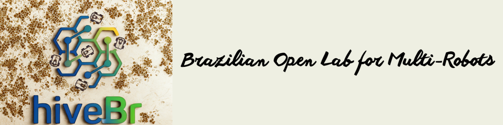
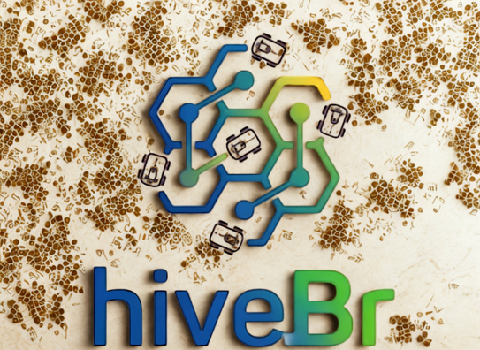

<p align="center">
  
</p>

**🐝hiveBr🐝** is a lightweight 2D simulation framework for single- and multi-robot
mobile navigation. It ships a Pygame-based physics/renderer engine and a clean
**OpenLab API** that lets the same user script run a fleet locally or on a
physical arena.

Robots in the simulator are called **B-bots** (for *bee*), keeping with the
hive metaphor.

---


## Why hiveBr?

- **Mono or fleet, one API.** A single robot is just a fleet with `N = 1`.
- **Dual paradigm.** Write *decentralized* logic with `HiveBrAgent` (one
  instance per B-bot) or *centralized* logic with `SwarmController` (one object
  for the whole fleet).
- **Interactive GUI.** Pan, zoom, load occupancy-grid maps, switch themes,
  toggle LiDAR, and add waypoints/obstacles with the mouse.
- **Two environment representations.** Analytic circular obstacles *and*
  image-based occupancy grids with inflation.
- **Precision sensing.** Ray-casting LiDAR using a DDA algorithm against the
  grid plus analytic circle intersections.
- **Deterministic fleets.** Every timestep is computed from a frozen snapshot of
  the fleet state, so results are independent of robot update order.
- **Research-ready.** Pluggable controllers, path planners (A*, RRT, RRT*, PRM,
  BIT*, OMPL, RRT-Dubins), and a data logger for offline analysis.

---

## A 20-second taste

```python
from hivebr import HiveBrAgent, SwarmExperiment

class Patrol(HiveBrAgent):
    def loop(self, state, neighbors):
        # state.goal holds the current waypoint (x, y, theta)
        return 0.5, 0.0

exp = SwarmExperiment(robots=3, backend="navsim2d")
exp.assign_agent(robot_ids=[0, 1, 2], agent_class=Patrol)
exp.assign_route(0, [[5, 2, 0.0], [5, 6, 0.0]])
exp.run()
```

Switching `backend="ros2"` reuses the *same* agent code on the physical lab.

---

## Where to go next

<div class="grid cards" markdown>

- :material-rocket-launch: **Getting started**

    Install hivebr and run your first B-bot in minutes.

    [:octicons-arrow-right-24: Quick Start](getting_started.md)

- :material-robot: **Robots, sensors & maps**

    Understand the five kinematic models, LiDAR and occupancy grids.

    [:octicons-arrow-right-24: Robot Models](robots.md)

- :material-sitemap: **OpenLab API**

    Master the dual paradigm: decentralized agents and centralized controllers.

    [:octicons-arrow-right-24: OpenLab API](openlab_api.md)

- :material-code-braces: **API reference**

    Auto-generated reference for every class and function.

    [:octicons-arrow-right-24: API Reference](api/index.md)

</div>

<p align="center">
  
</p>